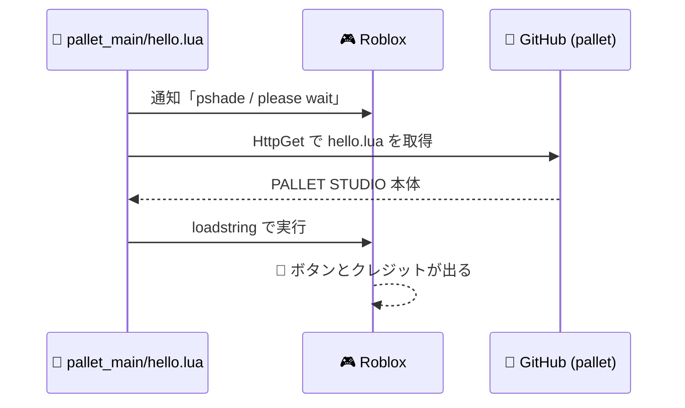

<div align="center">

# 🚀 pallet_main

**PALLET STUDIO の小さなローダー**

いつでも最新版の [`eisyu-tech/pallet`](https://github.com/eisyu-tech/pallet) を読み込みます。


</div>

---

## 📦 中身

```lua
game:GetService("StarterGui"):SetCore("SendNotification",{
	Title = "pshade",
	Text = "please wait",
	Icon = ""
})
loadstring(game:HttpGet("https://raw.githubusercontent.com/eisyu-tech/pallet/refs/heads/main/hello.lua"))()
```

## 🔧 動き



1. 右下に **「pshade — please wait」** という通知を出します。
2. `pallet` の `main` ブランチから `hello.lua` を取ってきます。
3. `loadstring` で実行すると、PALLET STUDIO が立ち上がります。

> [!TIP]
> 本体は毎回 `main` から取ってくるので、**`pallet` を更新するだけで、ローダーの方は何も変えなくても最新版になります**。

---

## ⚠️ 動く条件

| 条件 | 理由 |
|---|---|
| `loadstring` が使えること | Roblox は普通は無効です(`ServerScriptService.LoadStringEnabled`)。普通の LocalScript では動きません |
| `game:HttpGet` があること | 普通の Roblox スクリプトにはない関数です |
| **`eisyu-tech/pallet` が公開されていること** | `raw.githubusercontent.com` は、非公開リポジトリのファイルをログインなしでは返しません |

> [!CAUTION]
> `pallet` を非公開にすると、取得が失敗して `loadstring` がエラーになります。

---

## 🔗 関連

| リポジトリ | 役割 |
|---|---|
| [`eisyu-tech/pallet`](https://github.com/eisyu-tech/pallet) | 本体(UI・機能・説明は全部こっち) |
| `eisyu-tech/pallet_main` | このローダー |

機能の一覧や使い方は [`pallet` の README](https://github.com/eisyu-tech/pallet#readme) を見てください。

---

<div align="center">

**✦ make by aino ✦**

</div>
